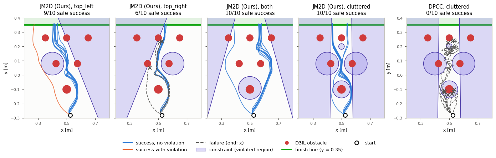

# Joint Model-based Model-free Diffusion for Planning with Constraints — D3IL-Avoiding

[[Project page]](https://jm2d-corl25.github.io/)
[[ArXiv]](https://arxiv.org/abs/2509.08775)
[[Code]](https://github.com/goldenhazard/JM2D)
[[Checkpoints]](https://huggingface.co/RoboWonsuhk/JM2D)

Wonsuhk Jung\*, Utkarsh A. Mishra\*, Nadun Ranawaka Arachchige, Yongxin Chen, Danfei Xu, Shreyas Kousik

Georgia Institute of Technology

This branch is the D3IL-Avoiding experiment of JM2D (paper Tables 2 and 3). Other experiments are on the branches
[`public_toy`](https://github.com/goldenhazard/JM2D/tree/public_toy) (2-D toy domain), [`public_robomimic`](https://github.com/goldenhazard/JM2D/tree/public_robomimic) (PointMaze) and [`public_hardware`](https://github.com/goldenhazard/JM2D/tree/public_hardware) (Franka mug pick-and-place).

---

## Overview

A Diffuser planner is trained on the D3IL Avoiding demonstrations, in which a robot moves its end effector in the
plane from a fixed start to a finish line through a field of obstacles. At test time, constraints the planner never
saw (halfspaces and discs) are added, in four scenarios: `top_left`, `top_right`, `both` and `cluttered`. A trial is a
safe success (**SSucc**) when the robot reaches the finish line without violating a constraint; **#Vio** is the number
of violating time steps.

- **Table 2** compares four planners: `dpcc` (DPCC, projection at every denoising step), `safediffuser` (SafeDiffuser,
  invariance QP, `--variant res|tvs`), `mpd` (MPD, cost-gradient guidance) and `jm2d` (Ours).
- **Table 3** varies the number of denoising steps u that JM2D uses to estimate clean samples (`--u-steps`).



*Top view of 10 trials per panel (checkpoint seed 0), drawn by `assets/make_figure.py` from `assets/traj/`.*

---

## Installation

```bash
conda create -n jm2d_d3il python=3.10 -y
conda activate jm2d_d3il
conda install -c conda-forge pinocchio=2.6.20 -y          # used by the D3IL simulator
pip install torch==2.2.2 --index-url https://download.pytorch.org/whl/cu121
pip install -r requirements.txt

# D3IL simulator, patched
git clone https://github.com/ALRhub/d3il.git third_party/d3il
git -C third_party/d3il checkout 1d9c718
git -C third_party/d3il apply ../d3il.patch
```

The patch rewrites the D3IL imports to the package path `d3il.environments...` and lets the environment start at a
given position (`third_party/README.md`). A CUDA GPU is required. Run all commands from the repository root, with
`PYTHONNOUSERSITE=1` if packages in `~/.local` shadow the environment.

`pytest -q tests` checks the first planning step of every golden case (`tests/golden/`) against the original code,
within 1e-4 (planned positions: 1e-3). The full bitwise episode check (`JM2D_GOLDEN_BITWISE=1 pytest -q tests`) needs
the original numeric stack: the cuDNN 8.9.7 of CUDA 11.8 on `LD_LIBRARY_PATH` and OpenBLAS 0.3.29 (conda-forge).

---

## Project Structure

```
├── assets/                 # README figure (make_figure.py + the paths it draws)
├── checkpoints/            # Diffuser planners, one per seed (scripts/download_checkpoints.py)
├── config/avoiding-d3il.py # training settings of the planner (horizon 8, 20 diffusion steps)
├── configs/
│   ├── scenarios.yaml      # constraint scenarios: top_left, top_right, both, cluttered
│   └── planners/           # dpcc.yaml, safediffuser.yaml, mpd.yaml, jm2d.yaml
├── diffuser/               # denoiser, sampling loops, constraint projector, JM2D sampler (models/jm2d.py)
├── jm2d_d3il/
│   ├── planners/           # dpcc, safediffuser, mpd, jm2d
│   ├── tasks/avoiding.py   # scenario -> constraint lists, environment
│   ├── runner.py           # episode loop and metrics
│   ├── experiment.py       # setup / run_job
│   ├── plotting.py         # top view of the trials (--plot)
│   └── summarize.py        # Table 2 / Table 3
├── paper/targets.json      # paper numbers (--check-paper)
├── results/
│   ├── paper/              # stored runs behind Table 2 DPCC / Ours
│   ├── rerun/              # runs with this code (Table 2 SafeDiffuser / MPD, Table 3, DPCC / Ours checks)
│   └── rerun_tables.md     # tables built from results/rerun (.json as well)
├── scripts/
│   ├── download_checkpoints.py # checkpoints; --data: the Avoiding demonstrations
│   ├── train.py            # train the planners
│   ├── run.py              # run a planner on scenarios, save results
│   ├── sweep.py, launch_sweep.sh   # job queue for all of Table 2 / Table 3
│   ├── summarize.py        # tables from saved results
│   └── plot_trajectories.py # figures from saved end-effector paths
├── third_party/            # d3il.patch (+ the D3IL clone)
└── tests/
```

---

## Usage

### 1. Download

```bash
python scripts/download_checkpoints.py          # 5 planners (seeds 0-4) -> checkpoints/avoiding-d3il/..., md5-checked
python scripts/download_checkpoints.py --data   # D3IL Avoiding demonstrations (96 .pkl, 2.6 MB), md5-checked
```

Both come from the [Hugging Face repo](https://huggingface.co/RoboWonsuhk/JM2D). The demonstrations (an unmodified
copy of the D3IL data, MIT License) are needed for training and for evaluation (the data normalizer is rebuilt from
them); `--data` writes them to `third_party/d3il/environments/dataset/data/avoiding/data/`, so clone D3IL first
(Installation). `--verify-only` checks an existing copy; `--dest DIR` (checkpoints) or `--data-dest DIR`
(demonstrations) downloads elsewhere; for checkpoints elsewhere pass `--ckpt-dir DIR` to `scripts/run.py`.
Alternative: extract the Avoiding folder of the [D3IL data archive](https://drive.google.com/file/d/1SQhbhzV85zf_ltnQ8Cbge2lsSWInxVa8/view) there.

### 2. Train

```bash
python scripts/train.py --seeds 0 1 2 3 4
```

One planner per seed (settings in `config/avoiding-d3il.py`: horizon 8, 20 diffusion steps, 100k training steps),
written to `logs/avoiding-d3il/diffusion/H8_K20_Dmodels.GaussianDiffusion/<seed>/` (`state_best.pt` + config
pickles). Use them with `scripts/run.py --ckpt-dir logs/avoiding-d3il/diffusion/H8_K20_Dmodels.GaussianDiffusion`.
If training stops with `unable to find an engine`, a cuDNN on `LD_LIBRARY_PATH` shadows the one of torch: unset it.

### 3. Run the planners

```bash
python scripts/run.py --planner jm2d --scenario top_left --seed 0 --n-trials 100        # Ours (Table 2)
python scripts/run.py --planner jm2d --u-steps 5 --scenario cluttered --seed 0-4        # Ours, u = 5 (Table 3)
python scripts/run.py --planner safediffuser --variant tvs --scenario both --seed 0-4
python scripts/run.py --planner dpcc --scenario top_left top_right both cluttered --seed 0-4
```

Each (planner, scenario, seed) runs `--n-trials` episodes of at most 200 steps and writes
`<out>/<label>/<scenario>/seed<k>.json`, with label = `dpcc`, `safediffuser-res`, `safediffuser-tvs`, `mpd`, `jm2d`
or `jm2d-u<u>`. An interrupted run resumes from its `seed<k>.trials.jsonl`.

| Argument | Description |
|---|---|
| `--planner` | `dpcc`, `safediffuser`, `mpd` or `jm2d` |
| `--variant` | SafeDiffuser variant: `res` (default) or `tvs` |
| `--u-steps` | JM2D: `full` (Table 2, default) or an integer u (Table 3: 0, 1, 2, 5, 10) |
| `--scenario` | one or more of `top_left top_right both cluttered` |
| `--seed` | checkpoint seeds: `0` (default), `0-4` or `0,2` |
| `--n-trials` | episodes per seed (default 100) |
| `--ckpt-dir` | checkpoint directory (default `checkpoints/avoiding-d3il/H8_K20_Dmodels.GaussianDiffusion`) |
| `--out` | output directory (default `results/runs`) |
| `--config` | another planner YAML (default `configs/planners/<planner>.yaml`) |
| `--batch-size` | override the number of plans sampled per step |
| `--no-resume` | start over instead of resuming |
| `--verbose` | JM2D: print the effective sample size and valid ratio every denoising step |
| `--save-traj` | also save the end-effector path of every trial to `seed<k>.traj.npz` (results unchanged) |
| `--plot` | `--save-traj` + draw the paths to `seed<k>.png` (section 5) |

All of Table 2 and Table 3 (10 labels × 4 scenarios × 5 seeds × 100 trials) run as a detached job queue; re-running
the launcher resumes it and `touch results/rerun_full/STOP` stops it after the running jobs:

```bash
scripts/launch_sweep.sh results/rerun_full 20 20000                    # [OUT] [WORKERS] [GPU_BUDGET_MIB]
python scripts/sweep.py status --out results/rerun_full --workers 20   # progress and ETA
```

JM2D hyper-parameters in `configs/planners/jm2d.yaml`: `num_mc_samples` (N = 100, clean samples per plan at every
denoising step), `u_steps` (u, denoising steps of each clean-sample estimate; `full` = full denoising),
`temperature` (λ = 0.05; the samples are weighted by softmax(−1000 · violation / λ)), `batch_size` (4 plans per
planning step) and `constraint_padding` (0.01, margin added to the constraints while planning). Override them with
`--config` or `planners.from_config("jm2d", num_mc_samples=50)`.

### 4. Add your own constraints

A scenario in `configs/scenarios.yaml` is a set of constraints on the end-effector position (x, y). The robot starts
at (0.525, −0.28) and must cross the finish line y = 0.35. Two constraint types:

- `halfspaces`: `[[x1, y1], [x2, y2], side]`, the line y = m x + b through two points (neither horizontal nor
  vertical); `below` keeps y ≤ m x + b feasible, `above` keeps y ≥ m x + b.
- `obstacles`: `{type: sphere_outside, dimensions: [x, y], center: [cx, cy], radius: r}`, a disc the end effector
  must stay out of.

`common` holds what all scenarios share (start position, active constraint types, episode length). To add a scenario,
append it under `scenarios:` and run it like a paper scenario:

```yaml
scenarios:
  # ... top_left, top_right, both, cluttered ...
  my_scenario:
    halfspaces:
      - [[0.75, -0.3], [0.55, 0.5], below]                  # feasible: left of / below this line
    obstacles:
      - {type: sphere_outside, dimensions: [x, y], center: [0.45, 0.0], radius: 0.05}
```

```bash
python scripts/run.py --planner jm2d --scenario my_scenario --seed 0 --n-trials 10   # -> results/runs/jm2d/my_scenario/
python scripts/run.py --planner dpcc --scenario my_scenario top_left --seed 0-4
```

For all planners at once, queue it with `python scripts/sweep.py plan --out results/my_sweep --scenarios my_scenario`
and start it with `scripts/launch_sweep.sh results/my_sweep`.

A new constraint shape needs a case in `jm2d_d3il/tasks/avoiding.py` (`precompute_constraints`), in the projector
(`diffuser/sampling/projection.py`) and in the violation count of `jm2d_d3il/runner.py`.

### 5. See the results

```bash
python scripts/summarize.py --results results/runs --figure table2 table3 --check-paper --out results/runs/tables.md
```

This prints Table 2 and Table 3 (SSucc mean ± std over seeds / #Vio), compares them with the paper
(`paper/targets.json`) and writes the report (an `--out` path ending in `.json` writes the tables as JSON). Table 2
takes DPCC and Ours from the stored paper runs (`results/paper/`) unless `--no-stored` is given. The tables cover the
four paper scenarios; for any scenario (e.g. your own), each `seed<k>.json` holds the trial means in `metrics`, and
the mean ± std over seeds is:

```python
from jm2d_d3il.summarize import aggregate_runs
cell = aggregate_runs(["results/runs"])[("jm2d", "my_scenario")]       # key: (label, scenario)
print(cell["ssucc"], cell["ssucc_std"], cell["n_vio"], cell["n_seeds"])
```

The shipped results, without a GPU:

```bash
python scripts/summarize.py --paper --figure table2 --check-paper       # stored paper runs (Table 2 DPCC / Ours)
python scripts/summarize.py --results results/rerun --figure table2 table3 --check-paper \
    --include-partial --min-partial-trials 10                           # = results/rerun_tables.md
```

`--include-partial` also aggregates seeds that have only a `seed<k>.trials.jsonl`; their cells are marked
`[Ns, Mt, partial]` (N seeds, M trials).

Top view of the trials (as paper Fig. 11): the scenario's constraints, the D3IL obstacles, the start, the finish
line and each trial's end-effector path, colored by outcome (`--save-traj` saves only the paths):

```bash
python scripts/run.py --planner jm2d --scenario cluttered --seed 0 --n-trials 10 --plot   # -> .../seed0.png
python scripts/plot_trajectories.py --results results/runs --label jm2d --scenario cluttered   # redraw, no GPU
```

---

## Citation

```bibtex
@inproceedings{jung2025joint,
  title={Joint Model-based Model-free Diffusion for Planning with Constraints},
  author={Wonsuhk Jung and Utkarsh Aashu Mishra and Nadun Ranawaka Arachchige and Yongxin Chen and Danfei Xu and Shreyas Kousik},
  booktitle={9th Annual Conference on Robot Learning},
  year={2025},
  url={https://openreview.net/forum?id=E9t1ekt6W9}
}
```

## License

MIT (see `LICENSE`). Third-party code and its licenses are listed in `NOTICE`.

Acknowledgments: this code builds on [DPCC](https://github.com/ralfroemer99/dpcc),
[Diffuser](https://github.com/jannerm/diffuser), [Decision Diffuser](https://github.com/anuragajay/decision-diffuser),
[SafeDiffuser](https://github.com/Weixy21/SafeDiffuser) and [D3IL](https://github.com/ALRhub/d3il).
