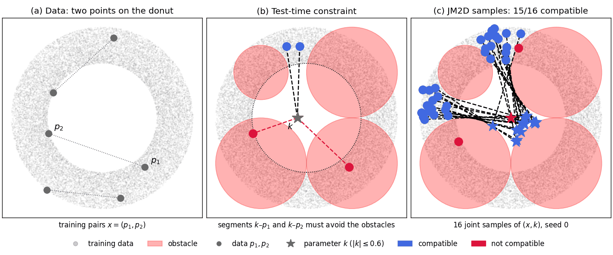
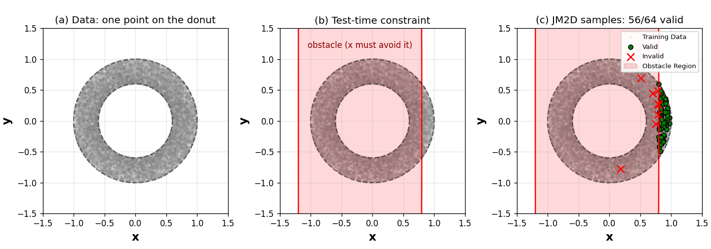

# Joint Model-based Model-free Diffusion for Planning with Constraints — Toy Domain

[[Project page]](https://jm2d-corl25.github.io/)
[[ArXiv]](https://arxiv.org/abs/2509.08775)
[[Code]](https://github.com/goldenhazard/JM2D)

Wonsuhk Jung\*, Utkarsh A. Mishra\*, Nadun Ranawaka Arachchige, Yongxin Chen, Danfei Xu, Shreyas Kousik

Georgia Institute of Technology

This branch is the 2-D toy domain of JM2D. Other experiments are on the branches [`public_robomimic`](https://github.com/goldenhazard/JM2D/tree/public_robomimic) (PointMaze),
[`public_d3il`](https://github.com/goldenhazard/JM2D/tree/public_d3il) (D3IL-Avoiding) and [`public_hardware`](https://github.com/goldenhazard/JM2D/tree/public_hardware) (Franka mug pick-and-place).

---

## Overview

A diffusion model is trained on a donut-shaped distribution. At test time, constraints the model never saw
(obstacles) are added, and the samplers below generate samples that satisfy them.

- **Joint sampling** (`donut_joint`, paper Fig. 2): sample data `x = (p1, p2)` together with a parameter `k` so that
  the segments `k–p1` and `k–p2` avoid circular obstacles. Samplers: `sequential`, `gibbs`, `jm2d`.



*`donut_joint`: (a) training pairs on the donut, (b) obstacles added at test time, (c) JM2D samples (blue: compatible).*

- **Constrained generation** (`donut_constrained`, paper Fig. 9): sample `x` in R^2 that avoids an obstacle while
  staying on the data distribution. Samplers: `projection`, `jm2d`.



*`donut_constrained`: (a) training points on the donut, (b) wall added at test time, (c) JM2D samples (green: valid).*

---

## Installation

```bash
conda create -n jm2d_toy python=3.8 -y
conda activate jm2d_toy
pip install torch==2.1.2 --index-url https://download.pytorch.org/whl/cu118
pip install -r requirements.txt
pip install -e .
```

A CUDA GPU is required. The trained models are included in `checkpoints/`, so there is nothing to download.
Run all commands below from the repository root. To check the installation: `pytest -q tests` (about 3 min on an
RTX 4090; without a GPU the GPU cases are skipped).

---

## Project Structure

```
├── assets/                 # README figures (make_figures.py)
├── checkpoints/            # trained denoisers: donut_joint.pth (x in R^4), donut_constrained.pth (x in R^2)
├── configs/                # sampler hyper-parameters: donut_joint.json, donut_constrained.json
├── jm2d_toy/
│   ├── samplers/           # jm2d.py, gibbs.py, sequential.py, projection.py
│   ├── tasks/              # problems: objective + constraint (donut_joint.py, donut_constrained.py)
│   ├── constraints.py      # obstacle shapes: circle, ellipse, rectangle (super-ellipse)
│   └── plotting.py
├── scripts/
│   ├── train.py            # train a denoiser
│   ├── run.py              # sample on a task, save results
│   └── compare.py          # table + figure from saved results
└── notebooks/toy.ipynb     # the same steps through the Python API (pip install notebook; jupyter notebook)
```

---

## Usage

### 1. Train

```bash
python scripts/train.py --dataset donut_constrained --out trained_models/donut_constrained   # x in R^2
python scripts/train.py --dataset donut_joint       --out trained_models/donut_joint         # x in R^4
```

Checkpoints are written to `<out>/model/model_step<k>e4.pth` every 10k steps and to `<out>/model/model.pth` at the
end. The shipped checkpoints are the 90k-step models.

| Argument | Default | Description |
|---|---|---|
| `--dataset` | `donut_constrained` | `donut_constrained` (constrained generation) or `donut_joint` (joint sampling) |
| `--out` | (required) | output directory |
| `--num_train_steps` | 100000 | training steps |
| `--hidden_dim` | 128 | width of the denoiser MLP |
| `--seed` | none | random seed |

### 2. Sample

Run the paper experiments (hyper-parameters from `configs/`):

```bash
python scripts/run.py --task donut_joint --planner sequential gibbs jm2d --seeds 0-4 --out results/runs   # ~1 min
python scripts/run.py --task donut_constrained --planner projection jm2d --seeds 0-2 --out results/runs   # ~7 min
```

| Argument | Description |
|---|---|
| `--task` | `donut_joint` (joint sampling) or `donut_constrained` (constrained generation) |
| `--planner` | samplers to run: `sequential gibbs jm2d` for `donut_joint`, `projection jm2d` for `donut_constrained` |
| `--seeds` | `0-4`, `0,2,7` or `0 2 7` |
| `--n` | number of samples (default from the config: 16 for `donut_joint`, 64 for `donut_constrained`) |
| `--config` | another config JSON |
| `--ckpt` | another checkpoint, e.g. one you trained |
| `--out` | output directory (results go to `<out>/<task>/<planner>/seed<k>.{json,npz}`) |

JM2D hyper-parameters in `configs/*.json`: `num_mc_samples` (N, Monte-Carlo samples per step),
`num_param_samples` (N_K, samples of k, joint sampling only) and `temperature` (λ).

### 3. Add your own constraints

Constraints are obstacles; a sample is valid when it is outside all of them.

```python
import numpy as np
from jm2d_toy import samplers
from jm2d_toy.tasks import DonutConstrainedProblem, DonutJointProblem

# constrained generation: x in R^2 must avoid a circle and a rectangle
problem = DonutConstrainedProblem(
    center=None,                                       # optional objective: distance to a point
    obs_types=["circle", "rectangle"],
    obs_centers=np.array([[0.6, 0.6], [-0.8, 0.0]]),
    obs_radius=[0.4, np.array([0.3, 2.0])],            # circle: radius; rectangle: half-widths (x, y)
)
sampler = samplers.make("jm2d", ckpt="checkpoints/donut_constrained.pth", num_mc_samples=512, temperature=0.1)
res = sampler.sample(problem, n=64, seed=0)            # res.x, res.valid, res.ood

# joint sampling: segments k-p1 and k-p2 must avoid circles
jproblem = DonutJointProblem(obs_centers=np.array([[0.0, 0.6], [0.0, -0.6]]), obs_radius=np.array([0.3, 0.3]))
jsampler = samplers.make_joint("jm2d", ckpt="checkpoints/donut_joint.pth",
                               num_mc_samples=128, num_param_samples=128, temperature=0.1)
jres = jsampler.sample(jproblem, n=16, seed=0)         # jres.x, jres.k, jres.compatible
```

Other samplers: `samplers.make("projection", ...)`, `samplers.make_joint("sequential" | "gibbs", ...)`.
For a new constraint shape, subclass `jm2d_toy.constraints.Constraint` (`evaluate(x) >= 0` means feasible). For a
new problem, subclass `jm2d_toy.tasks.TFGProblem` (or `TFGJointProblem`) and implement `objective_function`,
`constraint_function` (> 0 means infeasible), `is_ood` and `input_dim`.

### 4. See the results

```bash
python scripts/compare.py --results results/runs --task donut_joint --check-paper --out results/runs/figures/donut_joint.png
python scripts/compare.py --results results/runs --task donut_constrained --check-paper --out results/runs/figures/donut_constrained.png
```

This prints the counts per sampler (mean ± std over seeds), compares them with the paper and draws the figure.

`python scripts/compare.py --paper --task donut_joint` redraws the paper figure from the stored paper runs (no GPU).

To plot samples from the Python API (e.g. the example above):

```python
import matplotlib.pyplot as plt
from jm2d_toy.plotting import plot_constrained_samples, plot_joint_samples

fig, (ax1, ax2) = plt.subplots(1, 2, figsize=(10, 5))
plot_constrained_samples(ax1, problem, res.x, res.valid, title="JM2D")
plot_joint_samples(ax2, jproblem, jres.x, jres.k, jres.compatible, title="JM2D", marker_scale=0.3)
fig.savefig("samples.png")
```

---

## Citation

```bibtex
@inproceedings{jung2025joint,
  title={Joint Model-based Model-free Diffusion for Planning with Constraints},
  author={Wonsuhk Jung and Utkarsh Aashu Mishra and Nadun Ranawaka Arachchige and Yongxin Chen and Danfei Xu and Shreyas Kousik},
  booktitle={9th Annual Conference on Robot Learning},
  year={2025},
  url={https://openreview.net/forum?id=E9t1ekt6W9}
}
```

## License

MIT (see `LICENSE`). Third-party code and its licenses are listed in `NOTICE`.
